  

## I'm humble enough to know I'm replaceable at work.
*But I'm confident enough to know that it would take 4 people.*

     
        
  

 

*Personal projects*
- :video_game: [videogamers.fyi](https://videogamers.fyi)
- :stadium: [fanmatchday.com](https://fanmatchday.com)
- :electric_plug: [Obsidian Plugin: X Bookmarks Sync](https://community.obsidian.md/plugins/x-bookmarks-sync)
